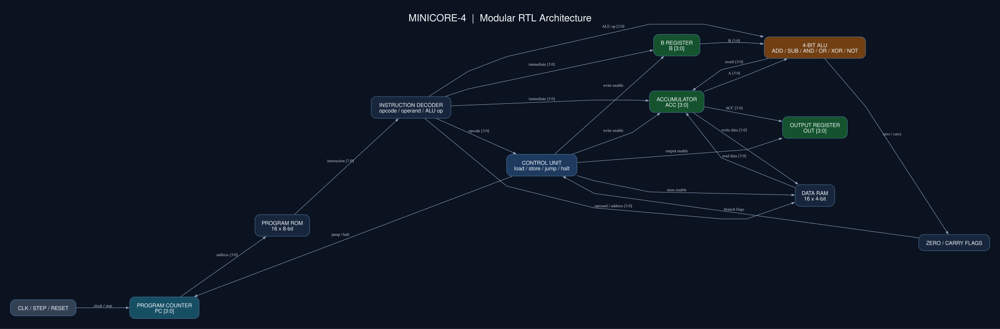

# MiniCore-4 — Custom 4-Bit CPU & Interactive Simulator

MiniCore-4 is a custom educational 4-bit CPU implemented in Verilog HDL, accompanied by an interactive React-based emulator and circuit explorer. Follow a program from an assembly instruction to register updates, memory operations, and the digital circuits that perform the work.

## Overview

The project connects digital logic design, computer architecture, instruction execution, binary arithmetic, hardware simulation, RTL synthesis, and software emulation in one repository.

**The Verilog CPU** in [`MiniCore4-Hierarchical/`](MiniCore4-Hierarchical/) is the authoritative hardware design. **The TypeScript emulator** in [`minicore4-web/`](minicore4-web/) reproduces its instruction-level behavior in the browser. The browser does not execute Verilog or synthesize hardware; automated tests compare the software model against Icarus Verilog simulation.

## Features

### CPU

- 4-bit data path with accumulator, B register, and output register.
- 16 instructions encoded in 8 bits; one instruction per rising clock edge when STEP is enabled.
- Six ALU operations: ADD, SUB, AND, OR, XOR, and NOT A.
- Zero and carry/borrow flags, unconditional jumps, and conditional branches.
- 16×8-bit program ROM and 16×4-bit data RAM.
- Reset and a halt state that holds the program counter.
- Hierarchical arithmetic: half adders → full adders → 4-bit ripple-carry adder.

### Browser application

- Assembly editor and assembler with labels, comments, validation, and machine-code output.
- STEP, RUN, PAUSE, RESET, and selectable execution speeds.
- Live registers, ROM/RAM inspectors, and expandable execution history.
- Interactive ALU, actual project schematics, and original Verilog source viewer.
- Six executable examples and a complete instruction reference.
- Responsive interface; execution stays in the browser with no backend.

## CPU Architecture



This image is a **manually specified module-level overview based on the RTL interfaces**. It is not a synthesized gate-level netlist. The supplied `*_rtl.svg` diagrams are generated from Verilog modules with Yosys and Graphviz.

| Component | Implementation |
| --- | --- |
| Data path | 4-bit unsigned values, 0–15 |
| Instruction | 8 bits: `[ opcode:4 ][ operand:4 ]` |
| Program counter | 4-bit address into ROM; increments modulo 16 unless a jump or halt overrides it |
| Accumulator A | Immediate loads, RAM loads, and ALU results |
| Register B | Immediate operand register used by the ALU |
| ALU | Arithmetic and bitwise operations on A and B; NOT uses A only |
| Instruction decoder | Splits opcode/operand and selects the ALU operation |
| Control unit | Combinational opcode decoding, register writes, memory operations, branches, output, and halt |
| Program ROM | 16 words × 8 bits, initialized to HLT before loading a hexadecimal ROM image |
| Data RAM | 16 words × 4 bits; asynchronous read and synchronous write; initialized to zero |
| Status flags | Stored Zero (Z), Carry/borrow (C), and halted state |
| Output register | 4-bit value copied from A by OUT |

`reset` clears PC, A, B, OUT, C and halted, and sets Z. RAM has no reset input and retains its contents. The `instruction` output is a combinational ROM read at the current PC; the CPU has no separate latched instruction register.

## Instruction Set

The high nibble selects the opcode; the low nibble supplies an immediate value or address. All operands are 0–15. Instructions without operands ignore the low nibble in RTL; the assembler emits zero for it. Mnemonics are defined by the web assembler and correspond to the following RTL opcode behavior.

| Opcode | Mnemonic | Description | Operand usage |
| --- | --- | --- | --- |
| `0x0` | NOP | Advance PC without changing data registers or flags | Ignored |
| `0x1` | LDI | A ← immediate; update Z | Immediate |
| `0x2` | LDB | B ← immediate; flags unchanged | Immediate |
| `0x3` | ADD | A ← A + B modulo 16; update Z and C (overflow) | Ignored |
| `0x4` | SUB | A ← A − B modulo 16; update Z and C (borrow) | Ignored |
| `0x5` | AND | A ← A AND B; update Z and clear C | Ignored |
| `0x6` | OR | A ← A OR B; update Z and clear C | Ignored |
| `0x7` | XOR | A ← A XOR B; update Z and clear C | Ignored |
| `0x8` | NOT | Invert all four bits of A; update Z and clear C | Ignored |
| `0x9` | STA | RAM[address] ← A; flags unchanged | RAM address |
| `0xA` | LDA | A ← RAM[address]; update Z, retain C | RAM address |
| `0xB` | JMP | PC ← address | ROM address |
| `0xC` | JZ | PC ← address if Z is set; otherwise advance | ROM address |
| `0xD` | JC | PC ← address if C is set; otherwise advance | ROM address |
| `0xE` | OUT | OUT ← A; flags unchanged | Ignored |
| `0xF` | HLT | Set halted and hold PC at the halt instruction | Ignored |

Branches retain flags. After HLT, further enabled clocks do not execute instructions until reset.

## Example Program

```asm
LDI 5
LDB 3
ADD
OUT
HLT
```

This program calculates **5 + 3 = 8** and copies the result to OUT. Its machine bytes are `15 23 30 E0 F0`; the hardware image is [`programs/addition.hex`](MiniCore4-Hierarchical/programs/addition.hex).

The original Verilog testbench confirms:

```text
PASS: 5 + 3 = 8; OUT=8; HLT holds CPU
```

## How Arithmetic Works

A **half adder** uses XOR for sum and AND for carry. A **full adder** combines two half adders and ORs their carry outputs to add A, B, and carry-in. Four full adders form the **ripple-carry adder**, propagating carry from the least significant bit to the most significant bit.

ADD uses this adder directly. SUB complements B and sets carry-in to implement two's-complement subtraction. Only the four result bits are stored, so arithmetic wraps modulo 16.

For ADD, **C** is the final carry-out and indicates unsigned overflow. For SUB, the RTL inverts the final carry-out so **C indicates borrow**. AND, OR, XOR, and NOT clear C. **Z** indicates that the last ALU result or value loaded into A is zero. LDI and LDA update Z while retaining C; other non-ALU instructions retain both flags.

## Interactive Web Simulator

The application is a browser-based processor laboratory:

- **Assembly editor:** write instructions, choose one of six examples, and inspect machine bytes before loading ROM. The two-pass assembler supports labels, decimal/hex/binary operands, and `;` or `#` comments, with line-specific errors.
- **Execution controls:** STEP executes one instruction; RUN uses a cleaned-up interval at 0.5, 1, 2, 5, or 10 instructions/second. PAUSE preserves state, RESET follows hardware reset behavior, and halt prevents further execution.
- **Live registers:** inspect PC, the instruction at PC, A, B, OUT, Z, C, and halted state. Instruction display follows the next PC after a step; history records the instruction just executed.
- **ROM/RAM inspectors:** view all 16 addresses, instruction decodings, numeric representations, current PC, and changed RAM cells.
- **Execution history:** inspect register, flag, memory, and output changes, with recorded state snapshots. The latest 256 entries are retained.
- **ALU explorer:** choose operands and one of the six hardware operations; the demo uses the same ALU function as the CPU model.
- **Circuit explorer:** inspect nine existing overview/RTL diagrams with zoom, drag pan, fit/reset, and fullscreen. Diagram provenance is labeled.
- **Verilog source viewer:** inspect selected original modules with keyword highlighting, copy code, or download the complete RTL source.

See the [web application README](minicore4-web/README.md) for implementation and deployment details. The existing app expects hosting at the domain root; GitHub repository publication does not configure GitHub Pages hosting under `/MiniCore-4/`.

## Technology Stack

| Hardware | Web |
| --- | --- |
| Verilog HDL | React |
| Icarus Verilog (`iverilog`, `vvp`) | TypeScript |
| Yosys | Vite |
| Graphviz | Tailwind CSS |
| | Motion and Lucide React |

## Project Structure

```text
MiniCore-4/
├── README.md
├── .gitignore
├── MiniCore4-Hierarchical/
│   ├── rtl/minicore4.v       # Authoritative CPU and hardware modules
│   ├── tb/minicore4_tb.v     # Original addition/halt testbench
│   ├── programs/            # ROM images
│   ├── scripts/             # Simulation and schematic generation
│   ├── diagrams/            # Graphviz sources and overview SVGs
│   └── build/               # Retained SVGs; other outputs are ignored
└── minicore4-web/
    ├── src/                 # React interface and TypeScript CPU/assembler
    ├── scripts/test.mjs     # Unit tests and Icarus differential tests
    ├── public/schematics/   # Required copies of actual project SVGs
    ├── public/source/       # Unmodified Verilog source for the viewer
    ├── package.json
    └── package-lock.json
```

The local parent directory may be named `miniCpu`; the intended GitHub repository name is **MiniCore-4**. The older local `MiniCore4-Portfolio/` sibling is excluded from publication; the two directories shown above form this project.

## Getting Started

### Prerequisites

- Node.js 22.18+ (Node 24 recommended) and npm.
- Icarus Verilog (`iverilog` and `vvp`) for hardware simulation and web RTL tests.
- Yosys and Graphviz (`dot`) for regenerating schematics.
- Bash for the hardware scripts.

### Hardware simulation

From the repository root:

```sh
cd MiniCore4-Hierarchical
./scripts/run.sh
```

The script compiles and runs the testbench, then writes `build/minicore4_sim` and `build/minicore4.vcd`. The short addition ROM file produces an Icarus `$readmemh` warning about fewer than 16 words; remaining ROM entries are initialized to HLT by the RTL. The test still passes.

Generate the supplied overview and module RTL schematics from the same hardware directory:

```sh
./scripts/schematic.sh
```

Outputs are written to `build/`. The web app uses committed copies under `minicore4-web/public/schematics/`; copy updated SVGs there when intentionally refreshing the app's diagrams. Similarly, keep `public/source/minicore4.v` identical to the authoritative RTL.

### Web application

From the repository root:

```sh
cd minicore4-web
npm install
npm run dev
```

Open the Local URL printed by Vite. For a reproducible installation from the committed lockfile, use `npm ci` instead of `npm install`.

Create and serve a production build:

```sh
npm run build
npm run preview
```

The production files are in `minicore4-web/dist/`; they are regenerated rather than committed.

## Testing & Verification

Run from `MiniCore4-Hierarchical/`:

```sh
./scripts/run.sh
```

Run from `minicore4-web/`:

```sh
npm test
npm run typecheck
npm run build
```

The following are observed results from the project's existing test runs, rerun during publication preparation on **2026-10-29**:

| Check | Observed result |
| --- | --- |
| Original Verilog addition/halt testbench | Passed; OUT=8 and HLT holds PC |
| Automated web test groups | 11 passed, 0 failed |
| Direct RTL comparisons | 3,457 passed |
| TypeScript checks | Passed |
| Production build | Passed |

Tests cover reset, decoding all 256 instruction bytes, addition, subtraction, overflow/borrow, bitwise operations, memory, branches, PC wrap, halt, assembly encoding/errors, and all bundled examples. Differential simulation compares all 1,536 supported ALU input/operation combinations, 48 deterministic random program traces, each opcode at each operand nibble, and a reset trace. Full CPU snapshots include PC, registers, flags, the instruction wire, and every RAM cell. The tests also compile and run the original hardware testbench in a temporary directory.

No emulator/RTL discrepancies were observed in these finite tests. This is simulation-based validation, **not formal verification**. Browser visual behavior, native fullscreen, and clipboard support still require a manual browser check. Schematic generation requires the external Yosys/Graphviz tools; retained diagrams are included so viewing the repository and running the web app do not require synthesis.

## Hardware Limitations

- Unsigned 4-bit values are limited to 0–15; arithmetic wraps modulo 16. No signed overflow flag exists.
- Program ROM has 16 addresses and RAM has 16 cells. Each instruction occupies one ROM byte.
- The 4-bit program counter wraps from 15 to 0 unless a branch or halt overrides it.
- RAM survives CPU reset; reset does not erase data memory.
- Subtraction C means **borrow**, and JC tests that same flag.
- There is no latched instruction register; the instruction output always reads ROM[PC].
- The instruction set has no stack, interrupts, indirect addressing, or external input instruction. B can be loaded only from an immediate.

## Future Improvements

Potential future work, **not implemented features**:

- FPGA implementation and board-specific clock/reset/I/O integration.
- Additional hardware verification, broader directed tests, and formal properties.
- Expanded instruction set and addressing capabilities, with corresponding emulator updates.
- Improved gate-level visualization and richer navigation of synthesized netlists.

## License

**Pending the project owner's decision.** No license has been selected or added.
